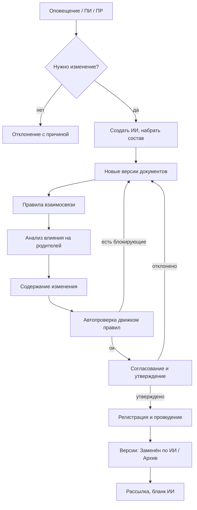

# 04. Внесение изменений

Основа: глава 7 методологии СТ3D, ГОСТ Р 2.503–2023, ГОСТ Р 2.504–2021. Процесс реализуется в модуле управления изменениями, но опирается на версии, состояния и блокировки из частей 01–03.

## 1. Цель

Дать способ менять компонент (сборочную единицу или деталь) и его документы так, чтобы:
- утверждённые версии не правились «на месте»;
- любое изменение имело основание, состав и историю;
- в любой момент можно получить состав и документы компонента на выбранную дату;
- перед согласованием изменение проходило автоматическую проверку.

## 2. Виды извещений

| Вид | Что меняет | Результат |
|---|---|---|
| ИИ | Подлинники документов и данные об изделии | Основная версия (1.0, 2.0…) |
| ПИ | Копии и дубликаты, находящиеся в производстве | Временная версия (1.1, 1.2…) на срок ПИ |
| ПР | Ничего, только описание предлагаемых изменений | Описание изменений |
| ДИ | Графы ИИ | ИИ новой редакции (2.0…) |
| ДПИ | Графы ПИ, только до окончания срока | ПИ новой редакции |

Изменение всегда связано с изменением условий применения: меняются состояние и применяемость. Не всякое извещение создаёт новую версию: допускается присвоение статуса без новой версии (литера, применяемость, аннулирование, сведения об организации производства).

## 3. Роли

| Роль | Что делает |
|---|---|
| Разработчик | Анализирует, готовит изменения, создаёт ИИ |
| Согласующий | Проверяет, подписывает с ХР |
| Утверждающий | Утверждает ИИ |
| Архивариус (БТД) | Регистрирует ИИ и проводит изменение |
| Держатель копий | Выпускает ПР и ПИ |
| Администратор | Настраивает маршруты и правила взаимосвязи |

## 4. Основной процесс: изменение подлинника по ИИ

1. **Инициирование.** Источник: оповещение, ПИ или ПР. Фиксируются источник и причина.
2. **Анализ необходимости.** Разработчик принимает или отклоняет. Для ПИ и ПР решение с причиной сохраняется. Отклонение ПР: ПР переводится в «Аннулирован», ответ идёт вне системы. Отклонение ПИ: запускается аннулирование ПИ.
3. **Разработка изменений.**
   - Создать ИИ и набрать состав: компоненты и документы.
   - Для каждого документа создать новую версию (состояние «Проектирование») или пометить на аннулирование.
   - Применить правила взаимосвязи: система предлагает добавить связанные объекты.
   - Выполнить анализ влияния на родителей (раздел 6).
   - Описать содержание изменения: текст, изображения, комментарии, по каждому документу и общее.
   - Определить, нужна ли новая версия или только смена статуса.
4. **Автоматическая проверка.** Движок правил запускается по всем новым версиям. Критические замечания блокируют отправку на согласование (настройка). Отчёт прикрепляется к ИИ.
5. **Согласование и утверждение.** Запуск процесса по шаблону (часть 05). К процессу автоматически прикрепляются ИИ и новые версии.
6. **Регистрация и проведение.** Архивариус регистрирует ИИ и проводит изменение. Новые версии становятся действующими, прежние сохраняются. Дата ввода может отличаться от даты проведения (Допущение).
7. **Рассылка.** Уведомление держателям копий и абонентам, формирование бланка ИИ.

Создание ИИ не всегда сопровождается новой версией. Для изменения статуса электронного документа (литера, применяемость, аннулирование, сведения об организации производства) присваивается дополнительный статус ранее утверждённым документам без новых версий.

## 5. Состояния при проведении

Изменение статусов при выпуске новой версии:

| Этап | Прежняя версия | Новая версия |
|---|---|---|
| Разработка изменений | Архив (действует) | Проектирование |
| Утверждение изменений | Архив (действует) | Утверждён |
| Учёт в архиве и проведение | Заменён по ИИ (период закрыт датой проведения) | Архив (действует с даты проведения) |

При аннулировании новая версия получает состояние «Аннулирован» с первого шага, прежняя после проведения становится «Заменён по ИИ».

Ветви процесса:
- **ПИ.** Меняются копии. Версии 1.1, 1.2…, срок ограничен. ДПИ допустим только до окончания срока или аннулирования. Выпускать ПИ может держатель подлинников и держатель копий.
- **ПР.** Только описание изменений. Версий не создаётся. Результат: принят или отклонён. Принятое ПР порождает ИИ, отклонённое переводится в «Аннулирован».
- **ДИ.** Правка граф ИИ после выпуска. Выпускает только держатель подлинников. Перечень изменяемых граф настраивается.
- **Ошибочный ИИ.** Исправляется новым ИИ, а не правкой старого.
- **Нарушена взаимозаменяемость.** Система предупреждает разработчика: нужен новый компонент с новым обозначением. Решение принимает человек.

## 6. Влияние изменения на сборочные единицы верхнего уровня

Принцип: каскада версий нет (D-05). При изменении детали или сборочной единицы версия родителя меняется только тогда, когда изменилось его собственное содержание. Это аналог бумажного архива: заменили лист в ящике, ящик остался прежним.

Связь «сборка → деталь» ведёт на компонент, а не на версию. Состав на дату строится по периодам действия версий.

Шаги при подготовке ИИ:
1. Система строит перечень «где используется» вверх по дереву до верхнего уровня.
2. Для каждого родителя разработчик фиксирует решение (таблица).
3. Решения «пересмотреть» и «новая версия» добавляют родителя в состав ИИ, для него шаги 1–3 повторяются выше.
4. Подъём заканчивается на родителе с решением «не затрагивается».
5. Все решения и обоснования сохраняются в ИИ и видны согласующим.

| Случай | Решение по родителю |
|---|---|
| Взаимозаменяемость сохранена, присоединительные размеры, масса, посадки, габариты не затронуты | «Не затрагивается». Версия родителя не меняется. Обязательное краткое обоснование. |
| Взаимозаменяемость сохранена, но затронуты посадки, масса, габариты, привязки, крепёж | «Пересмотреть». Родитель включается в ИИ, при необходимости выпускается новая версия сборочного чертежа, 3D-модели, спецификации. |
| Изменился состав спецификации (позиция, количество, обозначение) | «Новая версия» родителя: всегда. |
| Взаимозаменяемость нарушена | Новый компонент с новым обозначением. Спецификации всех родителей меняются, «новая версия» вверх по цепочке. |

Подсказки автопроверки (не решают за человека): изменились масса, габариты, материал, обозначение, количество в спецификации, номер ИИ в штампе.

## 7. Схема

## 8. Интеграция с автопроверкой

- Автопроверка использует существующий движок `checking/engine.py`. Запуск по каждому документу новой версии.
- Коды и тексты замечаний не менять (см. `docs/MIGRATION.md`). Сравнение версий добавляет отчёт «что изменилось в замечаниях между версиями».
- Дополнительные правила для изменений: совпадение обозначения и наименования между версиями, наличие записи в таблице изменений чертежа, совпадение номера ИИ с номером в штампе (набор уточнить).

## 9. Требования

| № | Требование |
|---|---|
| CH-01 | Создание ИИ, ПИ, ПР с обязательными полями: основание или причина, состав, содержание. |
| CH-02 | Создание новой версии документа из текущей утверждённой, прежняя версия не редактируется. |
| CH-03 | Утверждённую версию нельзя изменить или удалить, все правки через новую версию. |
| CH-04 | Аннулирование документа или компонента по ИИ. |
| CH-05 | Смена только статуса без новой версии (литера, применяемость, аннулирование). |
| CH-06 | Правила взаимосвязи при наборе состава: автодобавление связанных объектов, отказ только с обоснованием администратора. |
| CH-07 | Содержание изменения: текст, изображения, комментарии, общее и по каждому объекту. |
| CH-08 | Автопроверка новых версий, отчёт прикрепляется к ИИ, блокировка перехода при критических замечаниях (настройка). |
| CH-09 | Согласование по шаблону процесса, автоприкрепление ИИ и версий. |
| CH-10 | Регистрация и проведение: смена состояний, периоды действия, сохранение прежних версий. |
| CH-11 | Просмотр состава и документов компонента на дату. |
| CH-12 | Временные версии по ПИ (1.1, 1.2…), срок действия, ДПИ, автоматическое закрытие по сроку. |
| CH-13 | ПР не создаёт версий, принятие или отклонение с причиной. |
| CH-14 | ДИ/ДПИ: правка граф извещения, перечень изменяемых граф настраивается. |
| CH-15 | История изменений компонента: список ИИ, версии, кто и когда. Сравнение версий состава. |
| CH-16 | Бланк ИИ из шаблона (КОМПАС, DOCX, PDF). |
| CH-17 | Уведомления участникам и абонентам. |
| CH-18 | Право менять подлинники имеет только держатель подлинников. |
| CH-19 | Предупреждение при подозрении на нарушение взаимозаменяемости. |
| CH-20 | Перечень «где используется» для каждого изменяемого компонента на всех уровнях вверх. |
| CH-21 | Обязательное решение по каждому затронутому родителю, отправка ИИ на согласование без решений запрещена. |
| CH-22 | Решения «пересмотреть» и «новая версия» включают родителя в ИИ и повторяют анализ уровнем выше. |
| CH-23 | Автоматического создания версий родителей нет. |
| CH-24 | Подсказки автопроверки по затронутым родителям, только предупреждение. |
| CH-25 | В карточке ИИ и бланке отображаются решения по родителям и обоснования. |
| CH-26 | Перебазирование ИИ при проведении другого ИИ по тем же объектам (часть 02, VER-08). |

## 10. Критерии приёмки

1. Нельзя сохранить правку в утверждённой версии: система предлагает создать новую.
2. После проведения ИИ прежняя версия «Заменён по ИИ» с датой замены, новая действует. Просмотр по прошлой дате показывает прежнюю.
3. Изменение 3D СЕ без добавления компонента СЕ в ИИ невозможно (или с обоснованием администратора).
4. Критическое замечание автопроверки блокирует отправку на согласование.
5. ПР не создаёт версий. ПИ создаёт временные версии 1.1+ и закрывается по сроку.
6. Не-держатель подлинников не может провести изменение подлинника.
7. При замене версии детали без смены обозначения версии родителей не создаются автоматически, а состав на дату показывает новую версию детали.
8. ИИ нельзя отправить на согласование, пока по каждому родителю из перечня «где используется» нет решения.
9. Решение «пересмотреть» или «новая версия» добавляет родителя в ИИ и запускает анализ выше.

## 11. Открытые вопросы

1. Нужны ли ПИ, ПР, ДИ в первой версии или только ИИ? Предложение: этап 1 ИИ, правила взаимосвязи, автопроверка. Этап 2 ПИ и ПР. Этап 3 ДИ/ДПИ и рассылка абонентам.
2. Решение «не затрагивается» требует подписи ответственного за родителя, если родитель принадлежит другому подразделению?
3. Анализ «где используется» показывать сразу по всем уровням или поэтапно?
4. Есть ли обмен извещениями с внешними абонентами?

## 12. Версии и производственные заказы (предложено, ждёт подтверждения)

Статус: предложение. Основа: ответы заказчика по запущенным заказам и сравнение с методологией и кодом `erp-yarst` (часть 09).

### 12.1 Исходная ситуация

Заказ запущен по версии 1.0 изделия. Конструкторы вносят изменения, появляется версия 2.0. Нужно решить: с какой даты действует новая версия в новых заказах, что делать с запущенными заказами, где хранится старая версия, как учитывать одновременные изменения нескольких изделий.

### 12.2 Принципы

1. Все версии изделий хранятся в PDM. Копий состава в заказе нет. Новые заказы берут актуальную версию («Архив, актуальный»), одновременно актуальна одна версия.
2. Заказ ссылается на версию через обёртку (как в вашей системе). Старая версия остаётся доступной для просмотра из заказа.
3. **Запущенный заказ сам не переключается.** Решает ПДО отдельно по каждому заказу и по каждому заданию: доделать по старой версии или перевести на новую (решение заказчика).
4. История заказа хранится в самом заказе: «запущено по версии 1.0; с такой-то даты по такому-то извещению перешло на версию 2.0; задания такие-то доделаны по 1.0». Это «ревизии заказа».
5. Даты: по методологии версия начинает действовать с **даты проведения** извещения. Для запущенных заказов фиксируются отдельные указания (аналог граф «указание о внедрении» и «указание о заделе» извещения).

### 12.3 Пакет изменений на заказ

- Изменения по заказу оформляются **одним пакетом** (заявка с несколькими позициями). Внутри пакета у каждого изделия своя версия (изделие А 1.0 → 2.0, изделие Б 1.0 → 1.01), у каждой позиции свой разработчик и своё согласование.
- Две позиции на одно изделие в один пакет не попадают. Если по заказу уже идёт пакет, новая заявка вливается в него или встаёт в очередь (как в вашей системе).
- Заказ получает **одну новую ревизию** на весь пакет: что вошло, какие версии, дата проведения, номер извещения.
- **Проведение** пакета выполняется одним действием, а не заявка за заявкой. Режим (по кнопке ПДО или автоматически в заданное время, например 00:00) определяет заказчик. Согласованные до момента проведения позиции вступают в силу одной датой и «схлопываются» в одну ревизию заказа. Срочные пакеты ПДО проводит сразу.

### 12.4 Что решает ПДО при проведении

Для каждого затронутого заказа ПДО выбирает одно из:

| Решение | Что происходит |
|---|---|
| Доделать по прежней версии | Заказ остаётся на 1.0, ревизия фиксирует решение и причину |
| Перевести на новую версию с даты | Заказ переходит на 2.0, незавершённые задания переносятся, завершённые остаются по старой версии |
| Новая версия с номера изделия | Решение действует с указанного номера, предыдущие изделия остаются по старой |

Выбор делается по каждому заказу и по каждому заданию отдельно. Пока решения нет, заказ не переключается.

### 12.5 Уведомления

| Событие | Кому |
|---|---|
| Пакет изменений затрагивает заказ | ПДО (обязательно), мастер участка, технолог заказа, ответственный за заказ |
| Принято решение по заказу | Инициатор пакета, участники, мастера участков |
| Проведён пакет | ПДО, мастера, участники пакета и подписчики |
| Задание перенесено на новую версию | Мастер участка и рабочий (на «Экране в цеху», если нет входа в систему) |
| Срок решения ПДО истёк | ПДО и руководитель |

Рабочие без входа в систему видят статус на экране цеха. Неактивным больше 7 дней уведомления не шлются (как в вашей системе).

### 12.6 Требования

| № | Требование |
|---|---|
| WO-01 | Пакет изменений на заказ с несколькими позициями, каждая со своей версией изделия и согласованием. |
| WO-02 | Ревизия заказа: история «запущено по версии, перешло на версию, когда, по какому извещению, какие задания». |
| WO-03 | Запрещено автоматическое переключение запущенных заказов. Решение ПДО обязательно по каждому заказу и по каждому заданию. |
| WO-04 | Проведение пакета одним действием, режим (кнопка или по расписанию) настраивается. |
| WO-05 | Дата вступления в силу равна дате проведения. Для запущенных заказов хранятся указание о внедрении (дата или номер изделия) и указание о заделе. |
| WO-06 | Старые версии доступны для просмотра из заказа, в PDM остаётся только одна актуальная. |
| WO-07 | Применение версии не затрагивает заказы, которых нет в пакете. |
| WO-08 | Уведомления по таблице 12.5, ПДО получает уведомление при любом изменении, затрагивающем его заказ. |
| WO-09 | Срочные пакеты проводятся немедленно решением ПДО. |
| WO-10 | Для каждого заказа в карточке видно все ревизии и какие позиции вошли. |

### 12.7 Открытые вопросы

1. Достаточно ли одной даты проведения, или нужна своя дата и «с номера изделия» для каждого заказа?
2. Проведение пакета вручную (кнопка ПДО) или автоматически в заданное время?
3. Кому, кроме ПДО, уведомления о затронутых заказах: мастерам, технологам, ответственным за заказы?
4. Нужно ли указание о заделе текстом, как в извещении по ГОСТ Р 2.503, или достаточно решений по заданиям?
